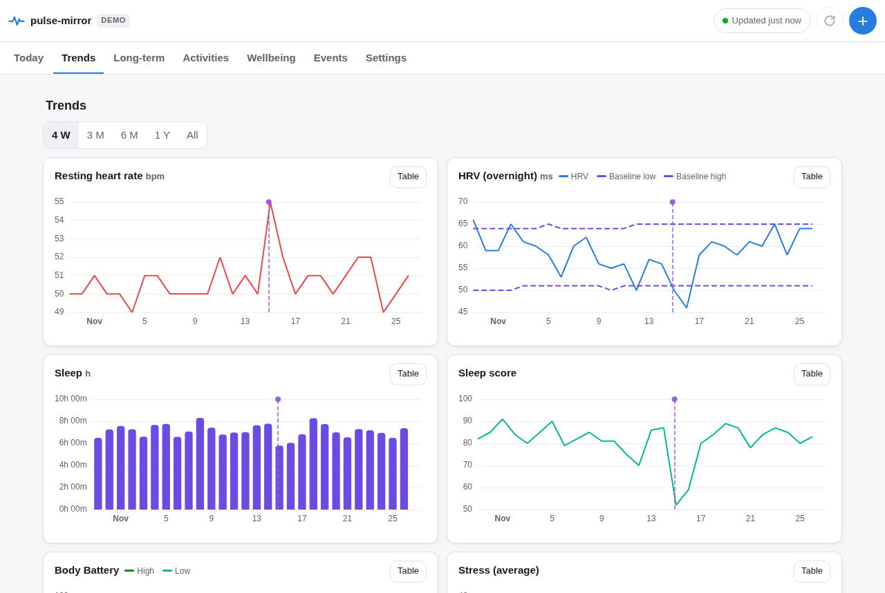
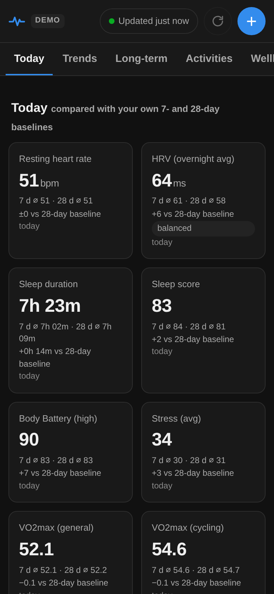
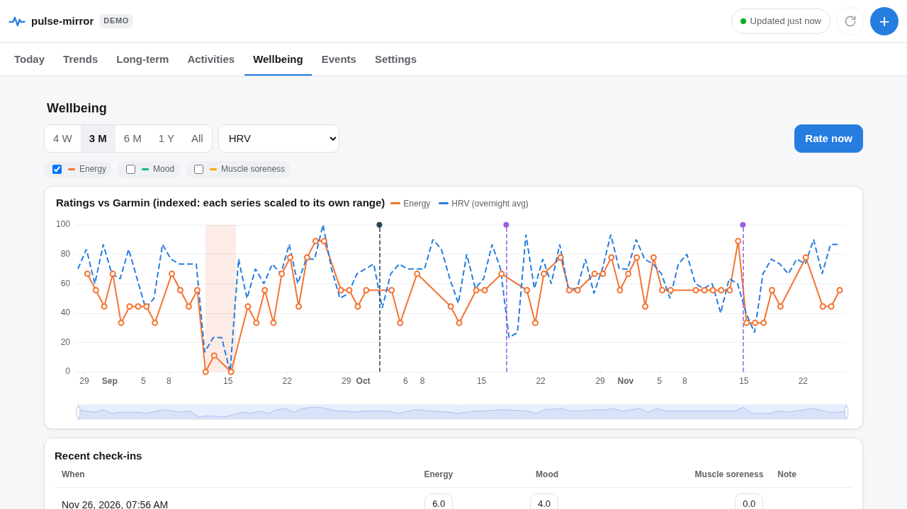
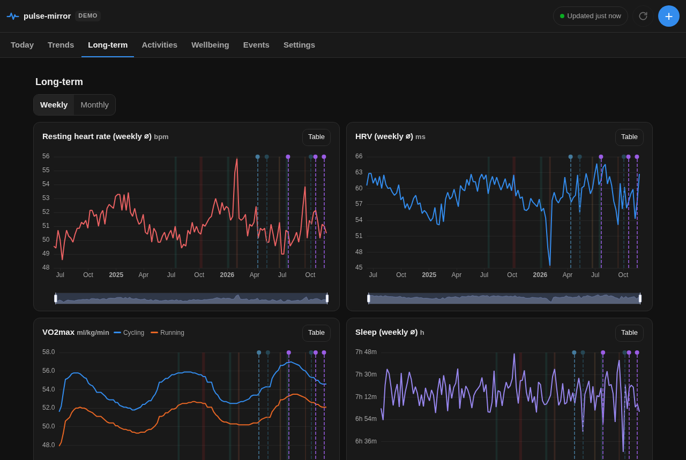

# pulse-mirror

> A local mirror of your Garmin data, visualized your way – self-hosted on a Synology NAS.

Garmin keeps the original data. **pulse-mirror** keeps a complete copy of it on your own hardware,
including your full history, and lets you look at it your way: against your personal baselines, over
months and years, and next to the things the watch can't know about. Trips, illness, a late night,
how you actually felt that morning.

**[Live demo →](https://rokemhb.github.io/pulse-mirror/)** (synthetic data; your edits stay in your browser)

<p>
  
  
</p>

## What it does

- **Mirrors Garmin Connect daily** (resting HR, overnight HRV and status, sleep stages and score, Body
  Battery, stress, VO2max, training load and status, steps, activities) and **backfills your whole
  history**, slowly, resumably, and in an idempotent way.
- **Your own annotations:** mark time spans ("cycling trip") or moments ("bad night", "flu jab").
  They show up as bands and markers in **every** chart, so you can explain the data later.
- **Wellbeing ratings on scales you define** (energy, mood, soreness, …). The scales are data, not
  code, and they are versioned, so changing a scale never breaks old ratings. Ratings can be overlaid
  with any Garmin metric.
- **Views:** Today vs. your 7/28-day baselines, 4-week to all-time trends, weekly/monthly long-term
  charts, activities, wellbeing. Mobile-friendly, light and dark, with a table view for every chart.
- **Exports:** CSV of everything, a weekly PDF report (e.g. into a Synology Drive folder), and an optional
  morning summary by email.
- **Ready for a mobile app:** a versioned JSON API (`/api/v1`, OpenAPI docs included) with per-device
  tokens and offline-safe rating uploads.

<p>
  
  
</p>

## Design principles

- **Your data stays home.** The database, the Garmin login tokens and the reports live only in a volume
  on your NAS. The repository contains code and synthetic or anonymized test data only.
- **Gentle with Garmin.** Requests are throttled and back off on rate limits, the login is never retried
  automatically, and there's no polling: one sync a day plus a refresh button with a cooldown.
- **Garmin is one source among several.** Every value records where it came from (`garmin`, `manual`,
  `app`, …), so new sources fit without a rebuild.
- **Failures are visible.** A sync problem (e.g. an expired Garmin login) shows up as a banner on the
  dashboard instead of failing silently.

## Architecture

```
GitHub ──Actions──▶ ghcr.io image (amd64 + arm64)
                         │
                         ▼
             NAS: one Docker container
             ├─ FastAPI: /api/v1 + dashboard (vanilla JS + ECharts)
             ├─ scheduler: daily sync, weekly PDF
             ├─ CLI: login, sync, backfill, backup, …
             └─ /data volume: SQLite, Garmin tokens, reports
```

Raw Garmin responses are stored first and mapped second, so mapping improvements can be re-applied to
the whole history without fetching anything again (`pulse-mirror remap`). All Garmin access goes
through a small adapter around [python-garminconnect](https://github.com/cyberjunky/python-garminconnect),
pinned to an exact version and tested against recorded, anonymized responses.

## Getting started

**On a Synology NAS:** follow **[docs/nas-setup.md](docs/nas-setup.md)**. In short: copy
`compose.yaml`, create `.env` from [.env.example](.env.example), run `docker compose up -d`, then
the two one-time interactive logins (dashboard password and Garmin), and start the backfill.

**Locally, for development:**

```bash
uv sync
uv run pulse-mirror demo serve          # dashboard on throwaway synthetic data, no login
uv run pytest                           # no network needed

uv run pulse-mirror login garmin        # one-time, interactive (password + MFA typed by you)
uv run pulse-mirror backfill garmin     # whole history, slow and resumable
uv run pulse-mirror auth set-password   # dashboard password (stored hashed)
uv run pulse-mirror serve               # http://localhost:8420, API docs at /api/docs
```

Run `uv run pulse-mirror --help` for everything else (`status`, `sync`, `remap`, `db backup`,
`report weekly`, `notify test`, …).

## Configuration

All settings are environment variables, usually set in `.env`:

| Variable | Default | |
|---|---|---|
| `PULSE_DATA_DIR` | `./data` (`/data` in Docker) | database, tokens, reports |
| `TZ` | `Europe/Berlin` | timezone for "today" and the schedule |
| `PULSE_PORT` | `8420` | web/API port |
| `PULSE_SYNC_TIME` / `PULSE_SYNC_DAYS` | `08:00` / `3` | daily sync time and how many days it refreshes |
| `PULSE_GARMIN_DELAY_S` | `3.0` | minimum seconds between Garmin requests |
| `PULSE_REPORT_TIME` / `PULSE_REPORT_DIR` | `20:00` / `$DATA_DIR/reports` | weekly PDF (Sundays) |
| `PULSE_SMTP_*`, `PULSE_NOTIFY_TO` | unset (off) | optional morning email, see `.env.example` |

## Status

Working and in daily use. Planned next: an Android app for wellbeing ratings (the API is ready for it),
optional access from outside the home network, and an MCP interface for asking questions about the data.
See [PLAN.md](PLAN.md) for the design and roadmap.

## Credits

- [python-garminconnect](https://github.com/cyberjunky/python-garminconnect) by cyberjunky and contributors (MIT)
- [Apache ECharts](https://echarts.apache.org/) (Apache-2.0, vendored in `src/pulse_mirror/web/vendor/`)
- [FastAPI](https://fastapi.tiangolo.com/), [ReportLab](https://www.reportlab.com/), [uv](https://docs.astral.sh/uv/)

pulse-mirror is an independent project. It is not affiliated with or endorsed by Garmin, and it uses an
unofficial way to access Garmin Connect that may stop working when Garmin changes things.

## License

[MIT](LICENSE)
